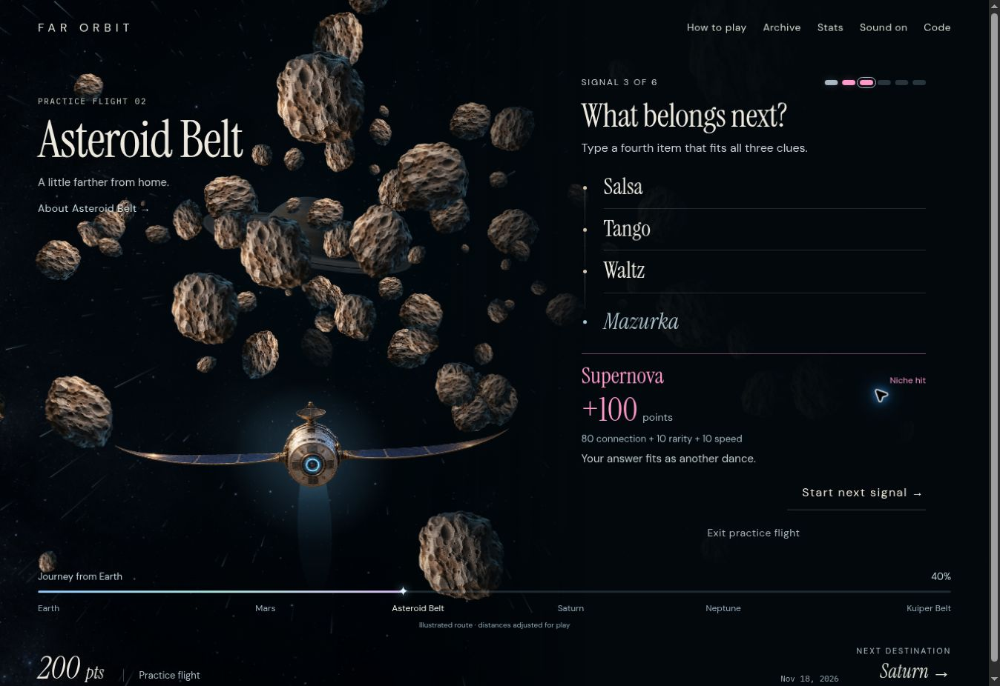
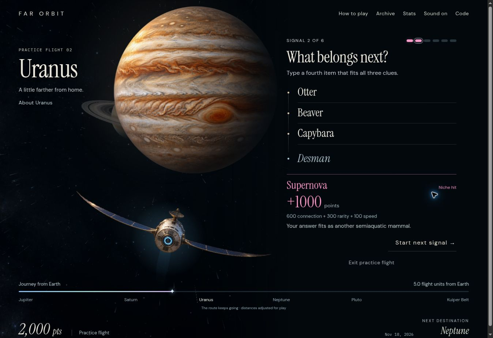
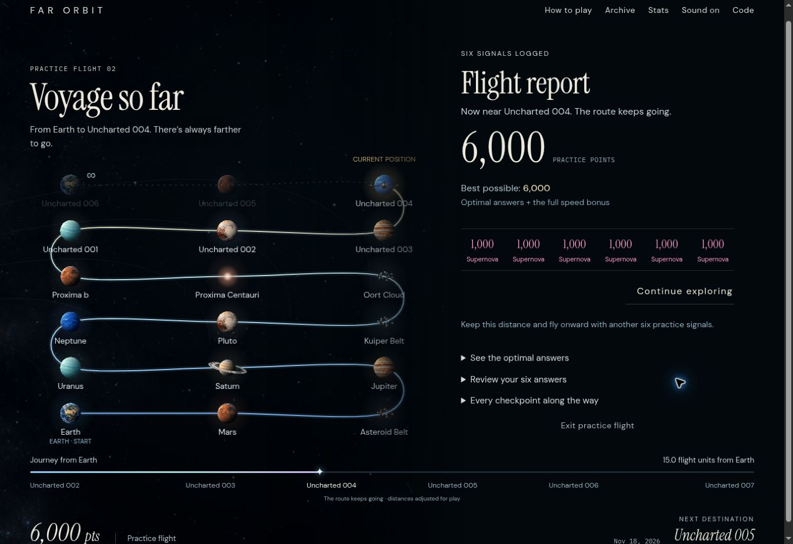

# Far Orbit

A daily browser word game with an animated solar system journey.

## Start on your Mac

Unzip the project and open its folder in Cursor or VS Code. Open a terminal in that folder and run:

```sh
python3 -m http.server 8000 --directory dist
```

Open http://localhost:8000 to play, or http://localhost:8000/code.html to read the source with explanations.

## Read the files

| File | Purpose |
| --- | --- |
| dist/scoring.js | Time limit, connection points, rarity bonus and speed bonus |
| dist/missions.js | Daily clues, accepted answers, hints and curated niche picks |
| dist/spelling.js | Typo distance, transposed letters and player-confirmed corrections |
| dist/game.js | Rounds, answer matching, saved progress, smooth timer and sharing |
| dist/route.js | Open-ended checkpoints, generated outer worlds, score-to-distance rules |
| dist/chart.js | Rear-view camera, layered artwork, panel flex, motion trails and field notes |
| dist/audio.js | Original ambient chords, reverb, answer sounds and mute preference |
| dist/legacy-missions.js | Base calendar for the updated daily missions |
| dist/index.html | The accessible controls and page structure |
| dist/style.css | Typography, spacing, clue ladder and mobile layout |
| dist/code.html | The source guide |
| dist/source.js | Fetches and explains the actual game files |
| dist/assets/ | Matching generated planet, sky, asteroid and rear-view probe artwork |

Try changing roundSeconds in scoring.js from 25 to 40. Save, refresh, and start a practice flight.

## Scoring

A related answer earns 120 connection points, a close answer 300, and a direct answer 600. A curated niche direct answer adds 300 rarity points. Speed adds up to 100 points: the first three seconds earn the full bonus, then it decreases proportionally with the remaining time. Each result shows its breakdown. The highest attainable score varies with each mission's available niche answers. Scores are grouped into six leagues in scoring.js. League colors are used in answer results, round markers and flight reports.

Rarity is authored for each puzzle. It is not calculated from population response data. Earlier scoring editions are retained as summaries in Stats. A fresh daily flight uses scoringVersion 2, so old and new score scales are not mixed. The flight report shows actual best-possible totals and all equally optimal authored answers, including the speed assumption.

## Add a mission

Each mission has six rounds. missions.js replaces narrow slots from the original calendar using replaceRound(day, signal, round(...)). New rounds have at least five direct choices. When a saved edition has different questions, its original answers and scores are retained under Earlier editions in Stats and a fresh daily flight is offered. This prevents an obsolete narrow question from returning after a reload. Update MISSION_REVISION when changing the authored calendar. The round arguments are clues, hint, direct answers, close answers, related answers, and optional niche answers. Different answers are separated by a vertical bar. A slash separates alternate names for the same answer.

Missions unlock at midnight in America/Chicago. The initial twelve missions cover November 17–28, 2026, after which the calendar cycles with a replay label. Append new missions to extend the schedule.

## Graphics

The scene uses matching generated illustrations of planets, asteroids, a starfield and a spacecraft viewed from behind. `flightPath` blends the planetary flybys into a continuous world-space corridor. The craft follows the route tangent with yaw and pitch, banks toward each passing planet, then eases level. A slower chase camera follows its actual position, so screen position is no longer tied directly to roll. Planets, stars and foreground rocks share that camera for depth-dependent parallax. `paintProbe` rotates and projects the artwork strips in three dimensions: the nearer wing grows while the farther wing recedes. Its long pointed panels retain a small flex while typing. The engine wake attaches to the projected nozzle and trails behind the heading. Automatic side-to-side idle sway is removed. Successful signals accelerate ahead; misses drift a little with the current object still visible. Sizes and distances are adjusted for the game, and reduced-motion preferences are supported.

## Audio

Quiet original ambient music starts after pressing Start. The Sound button mutes music and answer cues. Music fades out when the tab is hidden. Audio uses the browser Web Audio API and has no external music files.

## Journey and facts

The bar below the game shows progress along the illustrated route. It is a game measure with adjusted distances. Planet field notes appear beside the scene after a new encounter and can be reopened with the About button.

## Flight preview





## Spelling help

A typo such as Spanishs offers “Did you mean Spanish?” when Spanish belongs to the current puzzle’s authored answers. Tap Use Spanish to submit it. Suggestions do not score by themselves and do not pause the timer. Exact matching still ignores capitalization, accents and punctuation. Very short words are not guessed; equally close alternatives are shown as choices.

## Smooth flight and ending

Artwork is resized once when loaded. The icy Kuiper tint, soft star trails and glows are rendered to reusable textures instead of recomputed for every rock or star. Offscreen worlds are culled, probe banking eases across overlapping flights, and pixel density can step down on busy displays.

Opening the flight report pulls the camera back into a bird’s-eye route view. Earth marks the start, every checkpoint is labelled, the completed route glows and remaining checkpoints are dimmed along a dotted route. The probe marks the current position, with more route ahead. Distances remain adjusted for play. A completed save opens directly on its overview. Reduced motion shows the overview immediately.

## Validation

Run `node checks/banking.cjs` to verify the rendered spacecraft lowers the correct wing on both sides, changes near/far wing perspective, uses a projected pitched surface, follows a continuous camera path, and returns to level flight.

With Node installed, run `node checks/features.cjs` to check typo suggestions, confirmation-only scoring, ambiguity, mobile/reduced-motion drawing, current-position labels and cached Kuiper effects. Browser checks cover a complete practice flight, confirming a correction, and travel past Saturn into the outer belt.



## Open-ended exploration

The daily competition remains six signals, with up to 6,000 points on missions that offer niche choices in all rounds. Continue exploring preserves that voyage’s distance and all prior answers, then opens another six practice signals. Further legs have no hard limit. Exploration saves in this browser separately and survives a reload; its cumulative total can keep growing. Exploration uses the authored question bank, which eventually repeats; it is not a promise of infinitely new questions.

Travel is `points / pointsPerFlightUnit` with 400 points per unit. A top answer travels 2.5 units, passing multiple checkpoints. The bottom bar shows a moving local route window and total flight units from Earth instead of a fixed completion percentage.

The real route includes Earth, Mars, the Asteroid Belt, Jupiter, Saturn, Uranus, Neptune, Pluto, the Kuiper Belt, the Oort Cloud, Proxima Centauri and Proxima b. After these destinations, checkpoint generates imagined worlds without a final index. Their notes explicitly identify them as imagined. For very long trips, the overview compresses the middle and keeps Earth, the current position and upcoming worlds visible; the checkpoint ledger retains the full list.

Run `node checks/voyage.cjs` for scoring maxima, multi-planet jumps, indefinite checkpoint generation, distance-preserving continuation and lossless scoring migration. See docs/astronomy-sources.md for the new facts.
